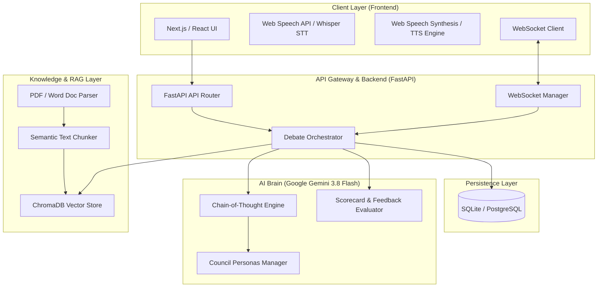
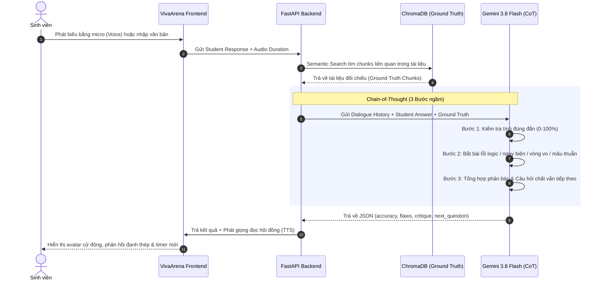
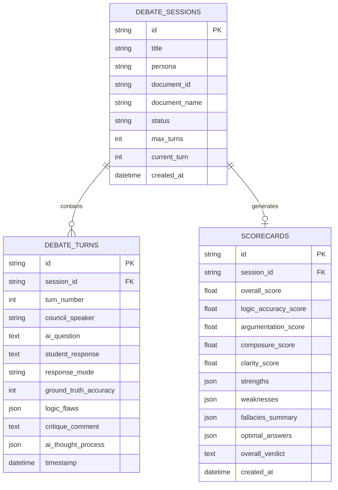

# KIẾN TRÚC HỆ THỐNG VIVAARENA (EDUTECH)
## Mô hình "Tranh biện cùng Phản biện AI theo Phong cách Hội đồng"

---

## 1. Tổng quan Kiến trúc (System Architecture)

VivaArena là nền tảng luyện tranh biện và mô phỏng bảo vệ đồ án học thuật ứng dụng Trí tuệ Nhân tạo thế hệ mới (Generative AI). Hệ thống chuyển đổi phương pháp học truyền thống từ **học thụ động (Passive Learning)** sang **học chủ động và truy vấn ngược (Active Learning & Retrieval Practice)** thông qua cơ chế phản biện thời gian thực.

---

## 2. Quy trình Xử lý Dữ liệu Chi tiết (Data & Interaction Flow)

### Bước 1: Nạp tài liệu & Kiến tạo Ground Truth (Document Ingestion & Indexing)
1. Giảng viên hoặc sinh viên tải lên tệp đề tài (PDF, DOCX, TXT) hoặc nhập tóm tắt đề cương.
2. `DocParser` trích xuất toàn bộ văn bản thô, làm sạch ký tự lạ và cấu trúc hóa tài liệu.
3. `Semantic Chunker` chia tài liệu thành các khối văn bản (chunks) từ 400 - 600 từ với độ gối đầu (overlap) 100 từ.
4. `ChromaDB` tạo embedding vectors và lưu trữ vào collection theo `document_id`. Đây là **Ground Truth** (kiến thức chuẩn mực) phục vụ việc đối chiếu khi tranh biện.

### Bước 2: Quá trình Tranh biện Thời gian thực & Kỹ thuật Chain-of-Thought (CoT)
Mỗi lượt đối đáp của sinh viên được AI xử lý qua 3 bước suy luận ngầm (Chain-of-Thought) trước khi phát ngôn:

### Bước 3: Đánh giá Toàn diện & Sinh Bảng điểm (Scorecard Generation)
Sau khi kết thúc phiên tranh biện (3 - 5 lượt), hệ thống thu thập toàn bộ lịch sử tranh biện và tạo Bảng điểm với 4 trục đánh giá:
- **Logic & Knowledge Accuracy (Độ chính xác kiến thức):** So sánh câu trả lời với tài liệu chuẩn.
- **Argumentation Skills (Kỹ năng lập luận):** Đo lường tính chặt chẽ, phát hiện ngụy biện.
- **Composure & Pressure Resilience (Bản lĩnh phản biện):** Khả năng ứng phó câu hỏi hóc búa.
- **Communication Clarity (Độ mạch lạc, rõ ràng):** Mức độ súc tích, tránh lan man.
- **Optimal Answers (Câu trả lời kiểu mẫu):** Cung cấp lời giải mẫu chuẩn học thuật cho từng câu hỏi.

---

## 3. Kiến trúc Cơ sở Dữ liệu (Database Schema)

---

## 4. Công nghệ & Thư viện sử dụng
- **Backend Framework:** FastAPI (Python 3.11+)
- **Large Language Model:** Google Gemini API (`gemini-3.8-flash` qua SDK chính thức `google-genai`)
- **Vector Database:** ChromaDB (Persistent Embedding Storage)
- **Document Processing:** PyPDF, python-multipart
- **Relational Database:** SQLite (Development) / PostgreSQL (Production)
- **Frontend Framework:** React 19 + TypeScript + Vite
- **Iconography & Styling:** Lucide React, Modern CSS Design System (Glassmorphism, Dark Mode)
- **Speech Technologies:** Web Speech Recognition API (Speech-to-Text tiếng Việt) & Web Speech Synthesis API.
